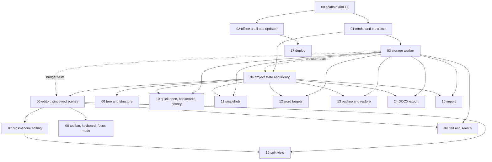

# Phase 1 specs

Phase 1 is the prose-writing MVP defined in `docs/PLAN.md` section 10: project tree, prose editor, composite view, navigation and search, snapshots, word targets, focus mode, offline PWA, backup file, DOCX manuscript export, and DOCX, Markdown and text import.

Read in this order:

1. `docs/PLAN.md`, especially section 6 (performance budgets) and section 13 (spike outcomes).
2. `architecture.md` in this directory: the decisions and contracts every package shares.
3. The spec of the package being built.

A **work package** is something one engineer can build in one reviewable pull request. Each spec has the same sections: goal; user-visible behaviour; contracts provided and consumed; data model changes; acceptance criteria; performance budgets; accessibility and mobile; out of scope; dependencies. A spec's contracts and `architecture.md` are precise enough that two packages with no dependency between them can be built at the same time without coordination. If a spec is unclear or wrong, fix the spec in its own pull request first.

## Packages in build order

| # | Spec | What it delivers | Depends on |
|---|---|---|---|
| 00 | `00-scaffold-ci.md` | Repository layout, tool chain, empty app shell, test harnesses, the CI workflow | none |
| 01 | `01-model-contracts.md` | Prose schema, plain text and positions, order keys, provenance rules, Yjs conversion, all shared types | 00 |
| 02 | `02-pwa-updates.md` | Installable app, offline start, the update flow that never mixes builds | 00 |
| 03 | `03-storage-worker.md` | SQLite on OPFS in a worker: write path, compaction, lock, migrations, tree and document storage | 01 |
| 04 | `04-project-state.md` | The four stores (tree, scene documents, undo, navigation), the library screen with restore from backup, the project screen's regions | 01; 03 for browser tests |
| 05 | `05-editor-windowing.md` | The composite view: per-scene editors, mounting window, scroll anchoring, typing, formatting commands, undo keys | 01, 04; 03 for budget tests |
| 06 | `06-tree-structure.md` | Tree sidebar and sheet: create, rename, drag to reorder, split, merge, Trash, details | 04 |
| 07 | `07-cross-scene-editing.md` | Caret movement, selection, copy, cut, paste and delete across scene boundaries | 05 |
| 08 | `08-editor-chrome.md` | Formatting toolbar, on-screen keyboard handling, focus mode | 05 |
| 09 | `09-find-search.md` | In-app find and project-wide search, text and regular expression | 03, 05 |
| 10 | `10-navigation.md` | Quick open, bookmarks, back and forward | 03, 04 |
| 11 | `11-snapshots.md` | Manual and automatic snapshots, compare, restore | 03, 04 |
| 12 | `12-word-targets.md` | Manuscript and daily word targets, selected word count | 03, 04; 05 for the selection count |
| 13 | `13-backup.md` | Export of a whole project as one file, the proof that it restores, reminders, storage settings | 03, 04 |
| 14 | `14-docx-export.md` | DOCX in standard manuscript format | 01, 03, 04 |
| 15 | `15-import.md` | Import of DOCX, Markdown and text with a correctable split into chapters and scenes | 01, 03, 04 |
| 16 | `16-split-view.md` | Two panes side by side on wide screens | 05, 07 |
| 17 | `17-deploy.md` | Publishing `main` to the permanent address with the right headers | 00, 02, decision 1 |

## Dependency graph

## What can be built at the same time

Packages in the same row touch different files and can be written at the same time. Where one needs another in the same row to finish its tests, the note says so.

| Stage | Packages | Starts when |
|---|---|---|
| A | 00 | now |
| B | 01, 02 | 00 is merged |
| C | 03, 04 | 01 is merged. 04's unit work uses the in-memory storage client it defines; its browser tests need 03. |
| D | 05, 06, 10, 11, 12, 13, 14, 15 | 03 and 04 are merged. 13, 14 and 15 do not need the editor. 06, 10, 11 and 12 can be written alongside 05, but their end-to-end tests that look at the text need 05, so they merge after it. |
| E | 07, 08, 09 | 05 is merged |
| F | 16 | 07 is merged |
| any time after B | 17 | 02 is merged and decision 1 is made |

The longest chain is 00, 01, 04, 05, 07, 16. The first build a writer can use for real work is the end of stage D with 05, 06 and 13 merged: write, structure, and get the text out again. Packages 14 and 15 make it a manuscript tool; stage E makes it comfortable.

Why packages in one stage do not collide:

- Storage features each own one handler file that exists as a stub from package 03 (`architecture.md` section 6.3), and schema version 1 already contains every Phase 1 table, so no package adds a migration.
- Interface features each own one component file that exists as a stub from package 04, mounted in a named region of the project screen.
- Shortcuts are ids in one table from package 00.
- Features never import each other; they meet through the stores and the editor contract (`architecture.md` section 3).

## Done means

A package is done when all of these hold:

1. Every acceptance criterion in its spec is covered by an automated test that passes in CI, or, where the spec says "manual", by a result recorded in the pull request.
2. Every budget in its spec has a measurement in `tests/perf/` that passes, and the pull request states the measured figures.
3. The screens it adds pass the accessibility checks named in its spec.
4. It changes no contract in `architecture.md` or another package's spec. If it must, the contract change is a separate pull request that is merged first.
5. Runtime dependencies it adds are in the table in `architecture.md` section 3 and in `THIRD_PARTY_NOTICES.md` where code or fonts are bundled.
6. If what was built contradicts `docs/PLAN.md`, the plan is corrected in the same pull request.

## Open decisions for the owner

Each has a recommendation. Decision 1 blocks package 17 only; the others have defaults written into the specs and block nothing.

### 1. Where the app is hosted, and at what address

The built app is static files. Three hosts are possible, because Spike B found that storage needs no cross-origin isolation headers; had it needed them, GitHub Pages would have been ruled out.

| | GitHub Pages | Cloudflare Pages | Container on the owner's server |
|---|---|---|---|
| Cost and upkeep | none | none; needs an account and one deploy token | an image build in CI and a server to keep running |
| Control of cache headers | none: every file gets the same short lifetime | full, through `public/_headers` | full |
| Real 404 for missing files | yes, with `404.html` | yes, with `404.html` | yes |
| Availability for first visits and updates | the host's | the host's | the server's; an installed app keeps working offline either way |
| Custom domain | yes | yes | yes |

Two facts matter more than the table:

- **The address is permanent.** Everything a writer stores is kept by the browser under the app's origin. Changing the address later strands every writer's projects at the old one. Choose a domain the project controls, once, before anyone stores real work. Do not use `<user>.github.io/fjader/` (the origin is shared with the account's other sites, which could read the stored projects) or a host's own subdomain as the permanent address.
- **The update strategy does not depend on cache headers.** The service worker verifies and serves one complete build on any host (`architecture.md` section 11). Headers are a second layer of protection, and they shorten the time a first visit can be stale.

**Recommendation:** a custom domain, served by Cloudflare Pages. It gives the second layer (header control) at no running cost and without tying the app's availability to one server. If avoiding another account matters more than header control, GitHub Pages behind the same custom domain is acceptable, and moving between the two later does not change the origin. The owner's server is the fallback if neither is wanted.

### 2. Start building before the phone checks, or after

Spike B says not to start Phase 1 on its recommendation until its phone checklist has been run; Spike A's recommendation is provisional for the same reason.

**Recommendation:** start now, and run the Spike A and Spike B phone checklists on a real iPhone and a real Android phone while packages 00 to 02 are built; they do not depend on the outcome. The specs isolate each provisional choice in one module (`architecture.md` section 17), so a failed check changes one file, not the plan. The checks must be done before package 03 and package 05 are merged, because those two packages build on the provisional choices.

### 3. Selection across scenes on touch devices

The system's selection handles are expected to stop at a scene boundary (not yet tested). Custom handles are about ten days of work in Spike A's estimate.

**Recommendation:** accept selection within one scene on touch in Phase 1, with "Select scene" and "Select all" in the selection menu, as package 07 specifies. Revisit after the phone check and after writers have used it.

### 4. Find and replace

`docs/PLAN.md` section 7 lists find and search but not replace. Renaming a character across a manuscript is a routine need, and the write path for it exists (`SceneStore.apply`, grouped into one undo step).

**Recommendation:** add replace and replace all as one further package after 09, two to three days by Spike A's estimate. It is not in the specs because the plan does not name it.

### 5. Split view in the MVP

The plan puts split view in Phase 1. It is the last package and nothing depends on it.

**Recommendation:** keep it in Phase 1 but treat it as the first thing to postpone if the phase runs long. The first usable build does not need it.

### 6. Search without a full-text index

`architecture.md` section 9 drops the FTS5 index the plan named and Spike B partly kept, because a scan of the whole manuscript took 7 to 25 ms in Spike B and find needs the scan anyway. What is given up is relevance ranking and accent-insensitive matching.

**Recommendation:** accept. An index can be added later by one migration without touching anything else. This is listed as a decision because it reverses a line of the plan.

## Real-device checks still open

No real phone has been tested. Automated tests in desktop browsers do not close these.

| Check | Where the steps are | Must pass before |
|---|---|---|
| Storage on phones: speed, 20 kills, lock for ten minutes, memory pressure, restart, private tab, `persist()` | `docs/spikes/results/B.md`, "Manual phone checklist" | merging package 03 |
| Editing on phones: typing with autocorrect, dictation and composition; fling scrolling with and without `?anchor=native`; keyboard and toolbar; selection handles at a scene boundary; returning after a minute away | `docs/spikes/results/A.md`, section 6 | merging package 05 |
| The same editing checks on the real app | repeat the Spike A list on a build with package 05 | releasing a build to writers |
| On-screen keyboard and toolbar position | package 08, criterion 4 by hand on both phones | merging package 08 |
| Saving a backup and an exported file from an installed iPhone app | package 13 | merging package 13 |
| The update flow on an installed iPhone app | package 17, criterion 5 | first public release |
| Final Draft page counts against the current version (the comparison so far is against Final Draft 8 exports from 2012) | `docs/spikes/results/C.md`, section 9 | starting Phase 2; it does not affect Phase 1 |
